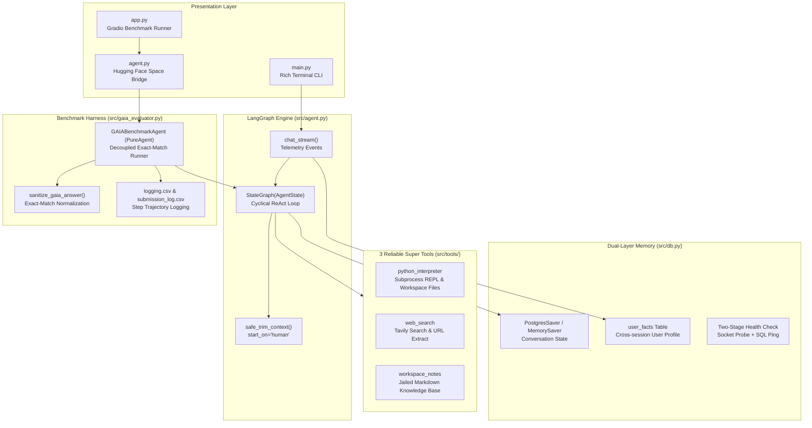

```
   __ _ __
  / /(_) /_ __
 / // / / // /
/_//_/_/\_, /
       /___/
```

[](https://www.python.org/)
[](LICENSE)
[](https://langchain-ai.github.io/langgraph/)
[](https://ollama.com/)

**A production-grade, locally-hosted AI assistant and GAIA benchmark solver powered by a LangGraph StateGraph ReAct loop with 3 consolidated Super Tools.**

Lily is a modular, resilient AI assistant that runs entirely on your local machine using [Ollama](https://ollama.com/) for LLM inference. Built on [LangGraph](https://langchain-ai.github.io/langgraph/) `StateGraph`, Lily features an autonomous cyclical ReAct engine, Strict PostgreSQL First persistent memory, safe sliding-window context trimming, and three reliable Super Tools. It is accessible through an interactive Rich terminal CLI (`main.py`) or a Gradio web harness (`app.py`) for Hugging Face GAIA benchmark evaluations.

---

## Table of Contents

- [Key Features](#key-features)
- [Architecture](#architecture)
- [The 3 Super Tools](#the-3-super-tools)
- [Tech Stack](#tech-stack)
- [Project Structure](#project-structure)
- [Quick Start](#quick-start)
- [Configuration](#configuration)
- [Usage](#usage)
- [GAIA Benchmark Evaluation](#gaia-benchmark-evaluation)
- [Contributing](#contributing)
- [License](#license)

---

## Key Features

- **LangGraph StateGraph Engine** — Autonomous ReAct execution graph (`START -> agent -> ToolNode -> agent`) with native checkpointer state persistence and recursion limit safety breakers.
- **3 Reliable Super Tools** — Consolidates legacy tools into three hardened, schema-validated Super Tools (`python_interpreter`, `web_search`, `workspace_notes`) with Pydantic V2 input validation and context guards.
- **Strict PostgreSQL First & Dual-Layer Memory** — Resilient persistence via `PostgresSaver` with two-stage health probes (TCP socket + SQL handshake) in production, and ephemeral `MemorySaver` for 100% offline unit testing.
- **Safe Context Window Trimming** — Sliding-window context management using `trim_messages(start_on="human")`, strictly eliminating orphan tool message errors while preserving the dynamic system prompt.
- **Real-Time Streaming Telemetry** — Multi-mode event streaming (`token`, `tool_start`, `tool_end`, `usage`, `error`) with live tokens/sec and execution duration tracking.
- **Decoupled GAIA Benchmark Harness** — Dedicated, isolated evaluation runner (`src/gaia_evaluator.py`) with strict exact-match answer sanitization, thread isolation, and step-by-step trajectory logging to `logging.csv`.
- **Dual Presentation Interface** — Interactive Rich CLI (`main.py`) with auto-complete slash commands, and a Gradio Web UI (`app.py`) for benchmarking and Hugging Face leaderboard scoring.

---

## Architecture



| Layer | Module | Responsibility |
|---|---|---|
| **Presentation** | `main.py` / `app.py` | Rich CLI and Gradio UI, slash commands, telemetry rendering |
| **Space Bridge** | `agent.py` | Clean root bridge exporting `PureAgent` for Hugging Face Space |
| **Agent Engine** | `src/agent.py` | LangGraph `StateGraph`, context trimming, ReAct cycle, streaming |
| **Tools Layer** | `src/tools/` | Consolidated 3 Super Tools with strict Pydantic V2 schemas |
| **Persistence** | `src/db.py` | PostgreSQL pool, `PostgresSaver`, `MemorySaver`, thread helpers |
| **Evaluation** | `src/gaia_evaluator.py` | Isolated GAIA benchmark agent, trajectory logging, answer sanitizer |
| **Configuration** | `src/config.py` | Centralized environment settings, constants, system prompts |
| **Utilities** | `src/utils.py` | Network retry decorators, LaTeX clean-up, token truncation guards |

---

## The 3 Super Tools

Consolidated from 17 fragmented utilities into 3 production-grade, hardened Super Tools:

| Tool | Schema / Input | Capabilities & Safety |
|---|---|---|
| **`python_interpreter`** | `PythonInterpreterInput` (`code: str`) | Executes Python code in a sandboxed subprocess (`cwd=os.getcwd()`, 15s timeout, UTF-8 pipe decoding). Enables data science analysis across workspace files (`pandas`, `openpyxl`, `PIL`, `pypdf`, `sqlite3`). |
| **`web_search`** | `WebSearchInput` (`query: str`, `max_results: int`) | Real-time dual-mode search via Tavily: automated URL detection triggers deep content extraction (`tavily.extract`), while keywords trigger targeted web search (`tavily.search`). Wrapped with `@retry_on_network_error`. |
| **`workspace_notes`** | `WorkspaceNotesInput` (`action: read/write/append/list/search`, `title: str`, `content: str`, `query: str`) | Manages Markdown knowledge base within a strict filesystem jail (`notes/`). Handles knowledge creation, continuous logging, full-text keyword search, and retrieval. |

---

## Tech Stack

| Component | Technology | Purpose |
|---|---|---|
| Framework | [LangGraph](https://langchain-ai.github.io/langgraph/) 1.2+ | Cyclical state machine, checkpointer persistence |
| LLM Inference | [Ollama](https://ollama.com/) | Local LLM inference (e.g. `qwen2.5:7b`, `gemma2:9b`) |
| Schemas | [Pydantic V2](https://docs.pydantic.dev/) | Strict input validation for all agent tools |
| Database | [PostgreSQL](https://www.postgresql.org/) + [psycopg3](https://www.psycopg.org/psycopg3/) pool | Long-term memory (`user_facts`) & thread checkpoints |
| Web Search | [Tavily](https://tavily.com/) Search & Extract API | Live internet research & deep webpage markdown extraction |
| Terminal UI | [Rich](https://github.com/Textualize/rich) + [prompt_toolkit](https://github.com/prompt-toolkit/python-prompt-toolkit) | Syntax-highlighted streaming CLI with history & autocompletion |
| Web UI | [Gradio](https://www.gradio.app/) | Benchmark runner & Hugging Face scoring integration |
| Code Quality | [Ruff](https://docs.astral.sh/ruff/) + [pytest](https://docs.pytest.org/) | PEP 8 linting (0 errors) & test suite (76 tests, 100% pass) |

---

## Project Structure

```
initio-lily/
├── main.py                  # Rich Terminal CLI entry point
├── app.py                   # Gradio Web UI (GAIA benchmark runner)
├── agent.py                 # Clean root bridge for Hugging Face Space (PureAgent)
├── pyproject.toml           # Project dependencies & tool configs
├── docker-compose.yml       # PostgreSQL Docker setup
├── .env.example             # Example environment template
│
├── src/
│   ├── agent.py             # LilyAgent — LangGraph StateGraph & ReAct engine
│   ├── config.py            # Centralized Single Source of Truth
│   ├── db.py                # PostgresSaver checkpointer & user_facts CRUD
│   ├── gaia_evaluator.py    # GAIABenchmarkAgent, answer sanitizer & trajectory
│   ├── utils.py             # Network retries, token guards, text sanitization
│   └── tools/
│       ├── __init__.py      # Exports ALL_TOOLS = [web_search, python_interpreter, workspace_notes]
│       ├── schemas.py       # Pydantic V2 schemas for the 3 Super Tools
│       ├── interpreter.py   # python_interpreter (Subprocess REPL)
│       ├── notes.py         # workspace_notes (Consolidated notes manager)
│       └── search.py        # web_search (Dual-mode Tavily search/extract)
│
├── tests/                   # 100% offline pytest suite (76 passing tests)
│   ├── test_agent.py        # LangGraph transitions, trimming, event streaming
│   ├── test_db.py           # Checkpointer contract, health checks, thread configs
│   ├── test_gaia_evaluator.py # Sanitizer, trajectory, and evaluation tests
│   ├── test_notes.py        # Path jail, CRUD operations, search
│   ├── test_tools.py        # Super Tools contract and payload drift tests
│   └── test_utils.py        # Token guards, LaTeX sanitization, retries
│
├── notes/                   # Local Markdown knowledge base directory
└── tasks/                   # Architecture refactor task specifications
```

---

## Quick Start

### Prerequisites

- **Python 3.12+**
- **[uv](https://docs.astral.sh/uv/)** package manager (recommended)
- **[Ollama](https://ollama.com/)** running locally:
  ```powershell
  ollama run qwen2.5:7b
  ```
- **PostgreSQL** *(optional, runs in ephemeral memory mode if offline)*:
  ```powershell
  docker compose up -d
  ```

### Installation

```bash
# 1. Clone the repository
git clone https://github.com/19165/initio-lily.git
cd initio-lily

# 2. Set up virtual environment and install dependencies
uv venv
# Windows
.venv\Scripts\activate
# macOS/Linux
source .venv/bin/activate

uv pip install -e .

# 3. Configure environment variables
cp .env.example .env
# Fill in TAVILY_API_KEY in .env
```

---

## Configuration

Create a `.env` file in the project root:

```env
# LLM Configuration
OLLAMA_MODEL=qwen2.5:7b
OLLAMA_BASE_URL=http://localhost:11434

# PostgreSQL Database (Optional — runs in ephemeral mode if unreachable)
POSTGRES_HOST=localhost
POSTGRES_PORT=5432
POSTGRES_DB=lily_db
POSTGRES_USER=lily_user
POSTGRES_PASSWORD=lily_secret

# External Tool APIs
TAVILY_API_KEY=your_tavily_api_key
```

---

## Usage

### Interactive Terminal CLI

```bash
uv run python main.py          # Standard streaming mode
uv run python main.py --debug  # Debug mode with syntax cards & tool telemetry
```

#### Available Slash Commands

| Command | Description |
|---|---|
| `/tools` | Display catalog and capabilities of the 3 Super Tools |
| `/notes` | View all Markdown files saved in the `notes/` knowledge base |
| `/facts` | View remembered user preferences and facts stored in PostgreSQL |
| `/model` | Inspect active LLM, host, memory window, and system status |
| `/stats` | View conversation turns, token usage, and tokens/sec generation speed |
| `/debug` | Toggle live debug telemetry cards during tool execution |
| `/clear` | Clear terminal screen |
| `/help` | Display command cheatsheet |
| `/exit` | Exit the CLI session |

---

## GAIA Benchmark Evaluation

Lily includes a built-in evaluation harness for the **Hugging Face Agents Course Unit 4** scoring server and the [GAIA benchmark](https://huggingface.co/gaia-benchmark):

### Launch Gradio Web UI

```bash
uv run python app.py
```
- Open `http://127.0.0.1:7860` in your browser.
- Enter your Hugging Face username.
- Click **🚀 Run Evaluation & Submit Answers**.
- After evaluation, the harness automatically generates:
  - `submission_log.csv` — High-level per-task execution summary.
  - `logging.csv` — Detailed step-by-step telemetry (tool calls, code snippets, execution duration, and outputs).

### Programmatic Benchmark Execution

```python
from agent import PureAgent

agent = PureAgent(max_steps=8, verbose=True)
answer = agent("What is the capital of France?")
print(f"Exact Answer: {answer}")
print(f"Trajectory: {agent.last_trace['trajectory']}")
```

---

## Verification & Testing

Run the deterministic test suite and linter:

```bash
# Run all 76 unit and contract tests (100% pass)
uv run pytest

# Check PEP 8 compliance across all files (0 errors)
uv run ruff check .
```

---

## License

This project is licensed under the [MIT License](LICENSE).

Built with 🌸 by [Prudtipon JITWIRIYANON](https://github.com/safefunny).
