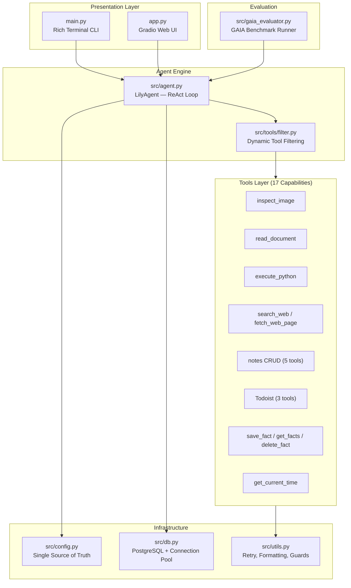

```
   __ _ __
  / /(_) /_ __
 / // / / // /
/_//_/_/\_, /
       /___/
```

[](https://www.python.org/)
[](LICENSE)
[](https://ollama.com/)

**A locally-hosted, privacy-first AI assistant powered by a ReAct agent loop with 17 built-in tools.**

Lily is a modular AI assistant that runs entirely on your machine using [Ollama](https://ollama.com/) for LLM inference. It combines a ReAct (Reasoning + Acting) agent loop with a rich set of tools — from web search and Python execution to persistent memory and task management — all accessible through an interactive Rich terminal CLI or a Gradio web UI.

---

## Table of Contents

- [Key Features](#key-features)
- [Architecture](#architecture)
- [Tool Catalog](#tool-catalog)
- [Tech Stack](#tech-stack)
- [Project Structure](#project-structure)
- [Quick Start](#quick-start)
- [Configuration](#configuration)
- [Usage](#usage)
- [GAIA Benchmark](#gaia-benchmark)
- [Contributing](#contributing)
- [Roadmap](#roadmap)
- [License](#license)

---

## Key Features

- **17 Built-in Tools** — Vision analysis, document reading, Python REPL, web search, local notes, Todoist tasks, and persistent memory.
- **ReAct Agent Loop** — Multi-step reasoning with structured tool calling and streaming output.
- **Persistent Memory** — User facts and preferences stored in PostgreSQL, with ephemeral fallback when the database is offline.
- **Sliding-Window Context** — Automatic conversation history management to stay within LLM context limits.
- **Token Telemetry & Debug Mode** — Real-time token usage tracking, generation speed metrics, and card-based tool tracing.
- **Dynamic Tool Filtering** — Intent-based tool selection to reduce schema overhead per request.
- **Dual Interface** — Interactive Rich CLI (`main.py`) with slash commands, and Gradio Web UI (`app.py`) for browser-based access.
- **GAIA Benchmark Harness** — Built-in evaluation runner for the [GAIA benchmark](https://huggingface.co/gaia-benchmark) with Hugging Face scoring integration.
- **Defensive & Fail-Safe** — Network retry decorators, graceful degradation, and context-safe output truncation.

---

## Architecture



| Layer | Module | Responsibility |
|---|---|---|
| **Presentation** | `main.py` / `app.py` | User-facing CLI and Web UI, rendering, slash commands |
| **Agent Engine** | `src/agent.py` | ReAct loop, LLM orchestration, streaming, context management |
| **Tools** | `src/tools/` | 7 sub-modules exposing 17 LangChain tools |
| **Infrastructure** | `src/config.py` | Centralized env vars, constants, system prompt |
| **Infrastructure** | `src/db.py` | PostgreSQL connection pool, session & memory persistence |
| **Infrastructure** | `src/utils.py` | Network retries, output formatting, LaTeX sanitization |
| **Evaluation** | `src/gaia_evaluator.py` | GAIA benchmark agent with trace logging |

---

## Tool Catalog

| Category | Tool | Description |
|---|---|---|
| 👁️ Vision | `inspect_image` | Analyze local images (.png, .jpg, .webp) with multimodal vision model |
| 📄 Documents | `read_document` | Extract text from PDF, CSV, Excel, TXT, MD, JSON files |
| 🐍 Python REPL | `execute_python` | Execute Python code in an isolated subprocess (15s timeout) |
| 🌐 Web & Search | `search_web` | Real-time web search via Tavily API |
| 🌐 Web & Search | `fetch_web_page` | Deep clean markdown extraction from web pages via Tavily Extract |
| 📝 Local Notes | `create_or_update_note` | Save or overwrite a Markdown note in `notes/` |
| 📝 Local Notes | `append_to_note` | Append content to an existing note |
| 📝 Local Notes | `read_note` | Read the full content of a local note |
| 📝 Local Notes | `list_notes` | List all Markdown files in the notes directory |
| 📝 Local Notes | `search_notes` | Full-text keyword search across all local notes |
| 📋 Tasks | `add_task` | Create a new Todoist task with natural language due date |
| 📋 Tasks | `get_tasks` | Query active tasks using natural filters |
| 📋 Tasks | `complete_task` | Mark a task as completed by title or ID |
| 💾 Memory | `save_fact` | Persist user facts and preferences to PostgreSQL |
| 💾 Memory | `get_facts` | Retrieve remembered facts by category |
| 💾 Memory | `delete_fact_by_key` | Remove a specific fact from persistent memory |
| ⏰ System | `get_current_time` | Get current date, timestamp, and timezone |

---

## Tech Stack

| Component | Technology |
|---|---|
| LLM Inference | [Ollama](https://ollama.com/) (local, any GGUF model) |
| Agent Framework | [LangChain](https://www.langchain.com/) (tool calling, message types) |
| Database | [PostgreSQL](https://www.postgresql.org/) + [psycopg3](https://www.psycopg.org/psycopg3/) connection pool |
| Web Search | [Tavily](https://tavily.com/) Search & Extract API |
| Task Management | [Todoist](https://todoist.com/) REST API |
| Terminal UI | [Rich](https://github.com/Textualize/rich) + [prompt_toolkit](https://github.com/prompt-toolkit/python-prompt-toolkit) |
| Web UI | [Gradio](https://www.gradio.app/) |
| Vision | Ollama multimodal models (e.g. `glm-ocr`) |
| Linting | [Ruff](https://docs.astral.sh/ruff/) |
| Testing | [pytest](https://docs.pytest.org/) |

---

## Project Structure

```
initio-lily/
├── main.py                  # Rich Terminal CLI entry point
├── app.py                   # Gradio Web UI (GAIA evaluation runner)
├── pyproject.toml           # Project metadata & dependencies
├── docker-compose.yml       # PostgreSQL + pgvector Docker setup
├── .env                     # Environment variables (not committed)
├── .env.example             # Example environment template
│
├── src/
│   ├── agent.py             # LilyAgent — ReAct loop, streaming, context
│   ├── config.py            # Centralized configuration (Single Source of Truth)
│   ├── db.py                # PostgreSQL connection pool & persistence
│   ├── gaia_evaluator.py    # GAIA benchmark evaluation harness
│   ├── utils.py             # Network retries, formatting, token guards
│   └── tools/
│       ├── __init__.py      # Tools registry (ALL_TOOLS, BASE_TOOLS, etc.)
│       ├── benchmark.py     # read_document, execute_python, inspect_image
│       ├── filter.py        # Dynamic intent-based tool filtering
│       ├── memory.py        # save_fact, get_facts, delete_fact_by_key
│       ├── notes.py         # Local Markdown notes CRUD & search
│       ├── search.py        # search_web, fetch_web_page (Tavily)
│       ├── system.py        # get_current_time
│       └── todoist.py       # add_task, get_tasks, complete_task
│
├── tests/                   # pytest test suite (49 tests)
│   ├── test_agent.py
│   ├── test_db.py
│   ├── test_gaia_evaluator.py
│   ├── test_notes.py
│   ├── test_tool_filter.py
│   ├── test_tools.py
│   └── test_utils.py
│
├── notes/                   # Local Markdown notes knowledge base
└── docs/                    # Project documentation & future plans
```

---

## Quick Start

### Prerequisites

- **Python 3.12+**
- **[Ollama](https://ollama.com/)** — installed and running with at least one model pulled (e.g. `ollama pull gemma4:cloud`)
- **PostgreSQL** *(recommended)* — for persistent memory and conversation history. Lily works without it in ephemeral mode, but memory and session persistence will be disabled.

### Installation

```bash
# 1. Clone the repository
git clone https://github.com/your-username/initio-lily.git
cd initio-lily

# 2. Create and activate a virtual environment
python -m venv .venv
# Windows
.venv\Scripts\activate
# macOS/Linux
source .venv/bin/activate

# 3. Install dependencies
pip install -e .

# 4. Copy and configure environment variables
cp .env.example .env
# Edit .env with your API keys and database credentials

# 5. (Optional) Start PostgreSQL with Docker
docker compose up -d

# 6. Run Lily
python main.py
```

---

## Configuration

Create a `.env` file in the project root (or copy from `.env.example`):

```env
# LLM Configuration
OLLAMA_MODEL=gemma4:cloud
OLLAMA_VISION_MODEL=glm-ocr:q8_0

# PostgreSQL Database (optional — runs in ephemeral mode without it)
POSTGRES_HOST=localhost
POSTGRES_PORT=5432
POSTGRES_DB=lily_db
POSTGRES_USER=lily_user
POSTGRES_PASSWORD=lily_secret

# API Keys (optional — enables respective tools)
TODOIST_API_KEY=your_todoist_api_key
TAVILY_API_KEY=your_tavily_api_key
```

---

## Usage

### Terminal CLI

```bash
python main.py          # Standard mode
python main.py --debug  # Debug mode with tool telemetry
```

Available slash commands in the CLI:

| Command | Description |
|---|---|
| `/tools` | List all available tools |
| `/notes` | View local notes knowledge base |
| `/facts` | View remembered user facts |
| `/tasks` | List all active Todoist tasks |
| `/today` | Show tasks due today or overdue |
| `/done <title>` | Mark a task as completed |
| `/model` | Show active LLM and system info |
| `/stats` | Show token usage analytics |
| `/debug` | Toggle debug / tool tracing mode |
| `/help` | Show command cheatsheet |
| `/clear` | Clear screen |
| `/exit` | Exit assistant |

### Gradio Web UI

```bash
python app.py
# Opens at http://127.0.0.1:7860
```

---

## GAIA Benchmark

Lily includes a built-in evaluation harness for the [GAIA benchmark](https://huggingface.co/gaia-benchmark) (General AI Assistants), which tests AI agents on real-world tasks requiring multi-step reasoning and tool use.

The evaluator (`src/gaia_evaluator.py`) wraps the `LilyAgent` with benchmark-specific prompting, trace logging, and automatic file resolution from local `GAIA/2023/` datasets.

Run via the Gradio UI:

```bash
python app.py
```

Or programmatically:

```python
from src.gaia_evaluator import GAIABenchmarkAgent

agent = GAIABenchmarkAgent(max_steps=6, verbose=True)
answer = agent("What is the capital of France?")
print(answer)  # "Paris"
print(agent.last_trace)  # Execution trace with tools, duration, tokens
```

---

## Contributing

Contributions are welcome! To get started:

1. **Fork** the repository
2. **Create** a feature branch (`git checkout -b feat/your-feature`)
3. **Make** your changes
4. **Run tests** to ensure nothing breaks:
   ```bash
   python -m pytest
   ```
5. **Submit** a Pull Request

---

## Roadmap

- [ ] **RAG / Vector Search** — Semantic memory retrieval using pgvector embeddings
- [ ] **Multi-Model Support** — Switch between LLM providers beyond Ollama
- [ ] **Voice I/O** — Speech-to-text and text-to-speech integration
- [ ] **Multi-Agent Orchestration** — Coordinated task execution across multiple agents
- [ ] **Calendar & Scheduling** — Calendar integration with proactive reminders
- [ ] **GAIA Leaderboard** — Extended benchmark coverage and leaderboard integration

---

## License

This project is licensed under the [MIT License](LICENSE).

---

Built by [Prudtipon JITWIRIYANON](https://github.com/safefunny)
